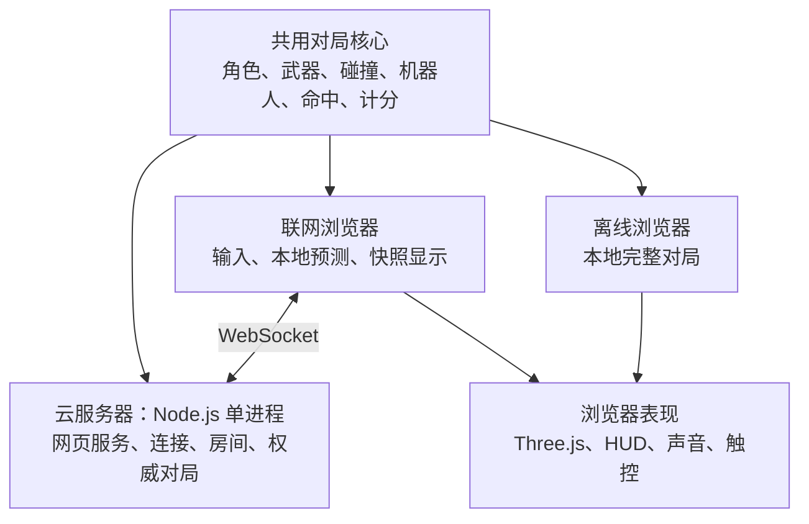

# 《运输船：暮雨行动》联网技术方案

状态更新：2026-11-16。S1—S4 软件与自动化已有通过记录，S5 本地工具与验证、规则统一、独立交付包和本地运行演练已完成对应工作；目标服务器、实机与网络体验仍待验，O4 未关闭，未进入 S6 整体验收。当前进度及各次授权以[分阶段实施计划](online-implementation-plan.md)为准。

产品依据：[联网产品设计](online-product-design.md)。本次修订纳入[技术评审意见](online-technical-review.md)及后续讨论：先验证真实联网交火，补齐同步字段、慢连接、多房间预算与姿态时间关系，并将状态同步确定为默认 60 Hz、低档 30 Hz 两档。另明确真人与机器人射击的显示引用绑定、远端姿态的唯一来源及引用失效回退。产品规则以产品文档为准；已确定的档位与仍需实测的参数分别标注。

实施时遵循[开发约定](development-guide.md)中的模块目录、依赖、状态所有权、启动入口和完成标准；发布与回退遵循[发布与运行约定](release-runbook.md)。这些规范不代表联网功能或目标工程命令已实现。

## 1. 目标与主要选择

在现有浏览器射击游戏中增加真人联网，继续支持团队竞技、中继争夺、机器人补位、对局中加入、平等的暂停权限，并保证离线版可以独立游玩。

当前处于玩法验证阶段。使用一台云服务器，通过 IP 地址访问；先采用单进程和内存房间。现阶段不引入数据库、账号、自动匹配、多地域部署、专门的反作弊或防护系统。

| 项目 | 本方案选择 | 原因 |
| --- | --- | --- |
| 对局权威 | 服务器统一运行联网对局 | 统一角色、命中、比分和计时；创建者离开后继续运行 |
| 游戏核心 | 在线、离线和本地预测复用必要的模拟代码 | 保持玩法一致，减少重复维护 |
| 服务端 | Node.js，沿用 JavaScript 模块 | 便于复用现有逻辑与工具链 |
| 首选通信 | 浏览器原生 WebSocket，服务端使用 `ws` 库 | 部署直接，适合先完成浏览器试玩；适用范围需经弱网验证 |
| 模拟与同步 | 模拟固定 60 Hz；状态同步默认 60 Hz、低档 30 Hz | 降低状态发送频率时保持移动、射速、碰撞和计分规则一致 |
| 本地操作 | 客户端预测，收到权威状态后重放未确认输入 | 保持即时响应并纠正偏差 |
| 其他角色 | 按服务器快照和时间缓冲平滑显示 | 平衡抖动与显示延迟 |
| 枪械命中 | 首版提供有限的历史命中盒回溯 | 让即时射线射击适应正常网络延迟 |
| 离线交付 | 保留无需网络、无需服务端的单个 HTML | 延续现有离线使用方式 |

## 2. 总体结构

服务器运行完整对局和机器人。联网客户端仅预测自己的必要操作，接收其他角色及共享场景状态；不在每个客户端重复运行整场机器人对局。

服务器不创建 WebGL 渲染器、DOM、材质或声音设备。可以继续使用 Three.js 的向量、矩阵等计算能力，不要求为了联网重新编写数学库。

### 2.1 多房间隔离与总预算

2026-11-15用户调整当前性能验收范围：单房最多10真人，或最多两房合计10真人以内，不再要求两房32真人。机器人继续补满4v4/5v5/8v8席位，两间8v8仍可能计算32个角色。当前2房/32连接为开发准入配置（含大厅连接），不是性能保证；本次只调整保证范围，不隐式改变准入行为。带宽、同步、新鲜度、CPU与队列门槛保持，证据见[优化记录](online-bandwidth-test-results.md)。

每个房间独立持有角色、机器人、比分、计时、暂停状态、输入队列、事件和命中历史。连接绑定到当前房间与角色，广播只遍历该房间成员。一个房间暂停、结束或销毁，不改变其他房间状态。

单进程内所有房间共享 JavaScript 事件循环。60 Hz 对应约 16.7 ms 的步进周期，全部活动房间的模拟与相关工作需要共同适应预算，并为编码、消息处理、垃圾回收和调度留余量。多个定时器或 `async` 不会让同步计算自动并行。[Node.js 事件循环说明](https://nodejs.org/en/learn/asynchronous-work/dont-block-the-event-loop)

配置固定的最大活动房间数和总连接数，达到上限时提示服务器繁忙；数值在目标服务器测试后确定，开放试玩前写入集中配置。容量验证覆盖多个各有一名真人、其余为机器人的房间，以及已有对局交火时创建新房间的初始化尖峰。一个 8v8 房间只有一名真人时，仍要计算另外 15 个机器人。

同一地图的静态布局、碰撞定义和可证明只读的导航数据可复用。现有 `World` 的查询标记、`NavGrid` 的搜索工作数组和其他临时缓冲须隔离或明确管理，不能将整个可变实例当作只读数据跨房间共享。进程退出会结束所有房间，当前阶段接受此故障范围。

## 3. 现有工程的改造边界

S1 改造前，`game.js` 同时管理模拟、渲染、输入和流程，角色创建直接依赖模型与场景。现已将地图、碰撞、角色移动、武器、AI、射击姿态、CPU 骨骼命中和伤害计算提取到 `src/sim/`，原离线入口通过表现适配调用共用计算。`game.js` 仍管理完整离线对局与界面；服务器不能直接实例化该浏览器对象。具体提取及对照证据见 [S1 测试记录](s1-test-plan.md)。

| 现有位置 | 保留与拆分方向 |
| --- | --- |
| [`src/game.js`](../src/game.js) | 提取对局状态、固定步进、伤害、复活、手雷和结算；浏览器部分继续管理画面与界面 |
| [`src/actor.js`](../src/actor.js)、[`src/player.js`](../src/player.js) | 分开角色模拟、真人输入采集和本地镜头；所有真人都能由服务器驱动 |
| [`src/bots.js`](../src/bots.js)、[`src/tactics.js`](../src/tactics.js) | 沿用 AI 和战术逻辑，脱离渲染；操作结果进入共用角色与武器计算 |
| [`src/physics.js`](../src/physics.js)、[`src/map.js`](../src/map.js) | 提取共用地图布局、碰撞体、出生点、据点和导航数据；地图画面使用同一份布局生成 |
| [`src/weapons.js`](../src/weapons.js) | 共用武器参数、状态机、散布和后坐力计算 |
| [`src/character.js`](../src/character.js) | 分开影响命中盒的姿态计算和模型表现；服务器保留命中所需姿态 |
| [`src/relay-state.js`](../src/relay-state.js)、[`src/objective.js`](../src/objective.js) | 沿用据点规则，分开占领判定、计分和据点显示 |
| [`src/touch.js`](../src/touch.js)、[`src/mobile-landscape.js`](../src/mobile-landscape.js)、[`src/hud.js`](../src/hud.js) | 保留浏览器操作体验，通过本地或联网会话执行对局操作 |
| [`build.mjs`](../build.mjs)、[`scripts/serve.mjs`](../scripts/serve.mjs) | 增加在线与离线构建入口，以及提供页面和 WebSocket 的游戏服务 |

`src/sim/` 已在 S1 创建并接入实际离线入口。S2 新增 `src/protocol/`、`src/net/`、`src/client/` 和 `server/` 的真实联网链路，旧表现层通过在线装配复用，完整产品流程仍待后续阶段；按职责逐步提取，不一次性搬迁全部文件。

### 3.1 共用计算与表现的边界

游戏核心接收操作和固定时间步，输出状态与事件。界面、声音、枪口效果、弹孔和动画根据状态与事件更新，不反过来决定伤害或比分。

真人或机器人属于模拟中的控制类型；“当前浏览器的玩家”由 `localActorId` 标识。现有 `isPlayer` 中混合的真人规则、本地声音和模型隐藏逻辑需要分别处理。

以下行为必须在拆分前后对照，不能仅靠共用参数表保证一致：

- 地图通道、楼梯、高台、出生保护和角色碰撞。
- 下蹲、跳跃、举枪、换弹、切枪和复活后的状态。
- 枪械散布、后坐力、受击偏转与实际射击方向。
- 角色姿态与头、胸、四肢命中盒。

目前 `Player.shotOrigin()` 使用镜头位置，`forward()` 包含后坐力和受击偏转。提取共用射击姿态时，需要保留影响弹道的偏移；纯表现效果可以留在客户端。不得在联网版中未经验证地改为另一套射击起点或粗略命中模型。

共用代码还需共用正确的输入状态与时间。步态初始相位、下蹲过渡、后坐力和受击动作等影响命中盒的状态必须可重建；客户端显示与服务器回溯的配对方式见第 7 节。局部提取后的实现先供真实离线入口和联网样例共同使用，按第 12 节逐步扩大范围。

## 4. 设置与交付方式

[共用规则配置](../src/sim/match-rules.js)提供对局时长、目标分数和机器人难度；武器定义继续共用 `src/sim/weapons.js`，中继计算沿用共用核心。在线权威、离线对局和浏览器展示从同一规则来源读取：最长 180 秒、目标为 50，机器人难度为常规，玩法和人数在开局时选择。

目标分数与机器人难度不属于个人设置，两种入口均不提供自定义选项。读取旧本地设置时清理 `goal`、`diff` 并保存迁移结果；保留玩法、人数、离线阵营、主武器及画面、灵敏度、视野、音量等个人选择。联网阵营仍由服务器分配。

人数选项沿用 4v4、5v5、8v8，每队容量分别为 4、5、8，房间总容量为 8、10、16。联网阵营由服务器按产品规则分配。主武器、画质、灵敏度、视野和音量仍由个人选择。

浏览器会话只需提供开始或加入、提交操作、配装、暂停、恢复和退出等必要调用，以及状态和事件通知：

- 本地会话直接驱动共用核心，运行完整对局和机器人。
- 联网会话通过连接提交操作，接收权威状态，并管理本地预测。

两种会话可以共用浏览器表现层，不需要模拟一套离线网络协议，也不要求保留延迟缓冲供离线使用。

在线页面和离线文件使用明确的构建入口。离线文件从本地会话启动，包含全部必要代码、资源和许可，不尝试连接服务器；不根据 `navigator.onLine` 自动切换运行方式。联网中断后按产品规则回到房间列表，不把进行中的多人对局切成单机继续。

离线版继续保留现有单机暂停与操作体验；联网全局暂停由服务器处理。设置与玩法共用不意味着将联网连接行为带入离线版。

## 5. 连接与数据协议

### 5.1 初始连接

在线页面使用当前页面的主机和端口连接 `/ws`：HTTP 页面使用 `ws`，HTTPS 页面使用 `wss`。不在客户端写死另一台服务器地址。

连接后交换协议版本、游戏构建标识和规则标识。版本不兼容时提示刷新，不允许不同碰撞或武器规则混入一场比赛。此检查不影响离线文件独立启动。

无需账号。连接内的临时身份、角色编号和昵称只用于当前会话；昵称可保存在浏览器。重新连接不恢复席位或个人战绩。

### 5.2 消息与状态

JSON 保留为最小样例的历史基线。当前高频输入、配对快照和射击事件采用固定 schema 二进制；公共几何与动画phase以误差≤0.00001 的 1/65536 网格为主，越界保留浮点；公共时间、计数与分支敏感量、输入和本人完整状态保持精确。普通射击广播只移除客户端不消费的五个回溯诊断字段，权威事件保留原值。服务器历史与客户端从同一规范化公共值重建，权威模拟和离线规则不量化。设计与实际证据见[带宽优化方案](online-bandwidth-optimization-plan.md)、[分阶段测试](online-bandwidth-test-plan.md)及[执行记录](online-bandwidth-test-results.md)。Suroi 的[位置编码](https://github.com/HasangerGames/suroi/blob/master/common/src/utils/suroiByteStream.ts)和[输入编码](https://github.com/HasangerGames/suroi/blob/master/common/src/packets/inputPacket.ts)仍仅作参考，其二维精度不能直接套用。

公共状态可相对客户端已确认的完整基准作 XOR 差量，客户端完整重建后与私人校正原子提交；输入/时钟携带独立 baseAck。每端只保留 active/offered 两份基准，替换待发包不依赖未确认状态；缺基准整包不提交，单次全量恢复≤3秒、最多两次/加入。阶段/成员 reset、生命边界、周期全量与清理合同见上述测试方案。公共体及本人状态按≤2 KiB 独立 raw DEFLATE 块编码，解压后总量≤128 KiB；服务器原生 zlib，浏览器使用锁定 fflate 0.8.3（MIT），不更改玩法或60/30 Hz档位。WebSocket permessage-deflate 继续关闭，无扩展连接也使用同一格式。[`ws` 压缩说明](https://github.com/websockets/ws#websocket-compression)

| 方向 | 消息职责 |
| --- | --- |
| 客户端 → 服务器 | 获取房间列表、创建、加入、操作帧及射击显示样本、配装、暂停、恢复、退出 |
| 服务器 → 客户端 | 房间列表、加入初始化、公共快照、本人校正、游戏事件、结算、操作失败原因 |
| 双向 | 握手、时间采样、存活检测 |

| 数据类型 | 必要内容 | 发送时机与处理方式 |
| --- | --- | --- |
| 房间列表 | 房间号、玩法、真人数、剩余时间、密码标志 | 进入列表及低频刷新；暂停房间应正确显示暂停状态 |
| 加入初始化 | 规则与构建标识、本人身份和阵营、当前角色元数据、完整当前动态状态及事件边界 | 加入成功时发送，覆盖正在进行或暂停的对局 |
| 角色元数据 | 角色编号、昵称、阵营、控制类型 | 初始化及成员变化时发送，避免每个模拟步重复传输 |
| 公共动态快照 | 房间与快照编号、模拟步、网络与对局时间、流程阶段、事件边界；全房角色的位置、速度、朝向、必要姿态、生命状态、可见武器动作；手雷、比分和据点 | 按所选同步档位发送，每房间每次构建和编码一次，向成员复用公共数据 |
| 本人校正 | 对应快照编号、生命和输入阶段、已执行或明确作废的输入边界、重放所需的自身完整预测状态 | 随对应快照只发给本人 |
| 游戏事件 | 事件编号、所属阶段和模拟步、相关角色与生命编号、射击关联编号及事件内容 | 射击、伤害、死亡、成员更替、暂停、恢复或结算发生时及时发送 |

公共快照与本人校正作为同一逻辑快照排队，使用一致的编号与状态边界；可以分别编码和发送，客户端集齐对应数据后再校正，不能将不同快照的公共状态和本人状态拼接。公共编码复用减少重复计算，不减少向每位玩家发送数据所需的出网带宽。[Colyseus 状态优化说明](https://docs.colyseus.io/state/optimization)

初期向全房同步必要角色状态，不实现可见性裁剪。地图、模型、材质、武器参数表、AI 寻路过程与个人画质设置不反复传输；雨、抛壳和弹孔等表现由客户端依据必要事件生成。

### 5.3 本人校正字段与事件应用

本人校正数据必须能恢复预测起点，不能只含位置、血量和弹药。字段以实际共用模拟依赖为准，至少核对以下范围：

- 位置、速度、朝向、接地、下蹲及过渡、眼高、跳跃冷却和影响射击起点的运动状态。
- 当前及上一武器槽、武器准备时间，以及各可切换武器的弹药与备弹、射击和拉栓冷却、换弹截止时间。
- 上次射击时间、连射计数、散布累积、随机状态或种子、射击序号和后坐力状态。
- 瞄准与开镜过渡、受击偏转的弹簧状态、待投掷与自动切枪等延迟动作。
- 生命、出生保护和输入阶段；死亡、复活时的明确重置边界。

对每个参与预测的状态标明“由权威快照恢复”或“可由已恢复状态和输入重新推导”，防止遗漏历史变量。[Colyseus 预测校正说明](https://docs.colyseus.io/netcode/client-prediction)

客户端权威状态副本通过快照或带明确版本的权威状态更新设置数值。事件用于确认操作、关联结果与播放表现，不在快照已覆盖伤害后再次扣血或计分。预测表现按射击或操作编号与事件关联，重放和服务器确认不能重复扣弹、播放枪声或执行击杀。

联网客户端中，远端角色包括其他真人和机器人，其后坐力、受击及其他影响可命中轮廓的骨骼状态，完全由快照采样和共用姿态计算决定。即时事件处理不得再调用现有 `kick()`、`flinch()` 或其他会额外改变这些骨骼状态的方法，也不能在快照姿态之外继续累积或衰减同一动作。事件可播放声音、枪口闪光等独立效果，不能把较新事件中的动作叠到较旧的插值姿态上。

本地玩家的预测后坐力与受击反馈继续使用自身预测、校正流程，不受远端角色这一显示约束替代。远端死亡、复活等会改变角色显示生命周期的切换也按对应插值时间应用，不因即时事件先到就提前改变其轮廓。[Unity 对预测与插值时间线的区分](https://docs.unity.cn/Packages/com.unity.netcode@1.5/manual/interpolation.html)

### 5.4 重要事件、慢连接与队列上限

加入结果、暂停、角色更替、伤害和结算等事件必须按顺序处理。连续的位置快照可被较新的完整快照替代。

每个连接独立观察发送积压字节、持续时间与状态新鲜度，使用 [`ws.bufferedAmount`](https://github.com/websockets/ws/blob/master/doc/ws.md#websocketbufferedamount) 等数据辅助判断。房间推进与广播不等待所有客户端确认，一个慢连接不能阻塞全房。

- 应用层每连接最多保留一份尚未发送的最新完整逻辑快照，旧快照连同对应本人校正一起替换。
- 积压超过配置阈值时停止追加快照；重要事件仍按序处理，但事件队列同样有字节量、数量或等待时间上限。
- 持续积压或状态过旧且无法恢复时，结束该连接，按断线规则补机器人；不能无限积累重要事件。
- 客户端上行发送、本地重放历史和服务器输入队列均有上限。已经进入 WebSocket 或 TCP 的字节无法撤回，不能把清空应用队列当作清除了传输积压。
- 初始阈值在最小样例中通过限速、短时断网和移动后台场景收敛，开放试玩前固定配置与验收条件。

输入超时或明显过期时，服务器清除按住的移动和开火状态，不在网络恢复后集中补执行历史射击。输入编号和生命、暂停边界共同用于判断有效性。

客户端同时检查最近快照接收间隔与权威状态年龄，当前上限均为 6 秒。旧数据持续到达不能刷新状态新鲜度；确认失败后立即通知本地会话退出、清理时钟和显示缓冲，并请求关闭传输，不等待 TCP 队列或关闭握手完成。迟到的消息与重复关闭不再次应用状态或通知。

新鲜度由连接自己的100ms定时器及输入/显示采样入口检查，不依赖角色存活、射击或对局是否暂停；合法暂停收到的新鲜快照保持连接。后台精度受浏览器调度限制，恢复执行时使用单调时间判断。服务器每秒ping带4字节序号，pong只与自己的发送记录匹配；最多8份待确认、按原6秒期限过期，重复/未知回复不刷新RTT或心跳。断线与应用关闭释放记录。

协议处理只加入维持对局稳定所需的有限数值与字段检查、连接到角色的绑定，以及消息大小、频率和模拟时间预算上限，避免错误数据拖垮所有房间；不扩展为专门防护平台。

## 6. 模拟、预测与时间

### 6.1 步进与时钟

客户端原始RTT保留诊断；时钟估计最多保留8份、8秒有效的匹配回复，最低RTT样本用于偏移，同值选新样本，旧序号/重复/未知回复不覆盖估计。输入提前量使用最近3份RTT的中位数（不足3份取较低中位），显示RTT以1/4权重跟进；持续路径变慢会跟进，过期的最低样本不能永久钉住时钟。参数是本轮实验初值，固定路径不对称仍不可由滤波消除；实施、验证及未解决的TCP尾延迟见[弱网前两步记录](online-weak-network-test-results.md)。

服务器和本地预测使用相同的 60 Hz 固定模拟步长。浏览器渲染频率独立，不能让角色速度或射速随帧率变化。网络消息到达不会直接额外推进角色时间。

区分两种时间：对局模拟时间用于武器、复活、据点和三分钟计时；单调递增的网络时间用于延迟采样、超时和恢复倒计时，暂停期间继续运行。避免直接比较两台设备的系统日期时间。

服务器按时间调度步进并监测落后。短时抖动可有限追赶；持续超预算视为容量或性能问题，不能通过静默改变步长掩盖。对局的运行时段还应由单调时钟监督：到达排除暂停与恢复倒计时的 180 秒边界时优先结算，不能因积压继续执行过期射击或计分。离线拆分时保持现有到时先结算的顺序。

### 6.2 操作帧

键鼠和触屏最终形成同一种操作帧，包含递增编号、所属生命与输入阶段、移动方向、视角、按住状态，以及开火边沿、跳跃、换弹和切枪等一次性操作。

真人每个 60 Hz 操作帧都携带最近一次实际显示的样本引用，持续按住开火时也更新；这里的操作帧不是浏览器渲染帧。同一渲染画面可以被多个操作帧引用，但不能为它伪造较新的显示时间。尚无有效显示样本时显式标记不可用，按第 7.4 节处理。

视角以玩家输入形成的瞄准角度提交；服务器使用共用规则计算有效后坐力、射击条件和弹道。一次性操作只消费一次，不能因同一输入被重放而在服务器重复生效。

服务器将输入安排到对应模拟步，按角色时间预算消费；缺失输入可以短时间沿用上一按住状态，超过输入新鲜度窗口则归零。迟到输入不能让角色在一帧内多走一段路。被作废的输入需要在确认信息中体现，客户端据此校正。

沿用输入只延续按住状态，不重复消费单次开火、跳跃、换弹或切枪等一次性操作。输入新鲜度与显示引用新鲜度分别检查：沿用不能刷新原输入或样本的时间；输入过期则停止沿用开火，输入仍有效但显示引用已失效时只关闭该发历史补偿。

输入确认边界表示状态中已经执行或明确作废的连续输入范围，不表示网络层仅仅收到了消息。输入帧的编号、所属阶段、目标模拟时间及消费规则在两端共用，避免不同设备帧率或网络恢复后改变移动与射击时间预算。

S3 实测固定提前三步不足以覆盖 150 ms RTT。当前客户端以 `max(3, ceil(RTT/2 × 60/1000 + 1))` 预留目标步提前量，再叠加估计的当前服务器模拟步；仍受 30 步未来窗口限制。到达不会增加服务器模拟步，迟到与过期输入仍作废，不通过恢复后补走解决延迟。

### 6.3 本地预测与校正

1. 浏览器为当前操作编号，保存输入并立即预测自身移动和必要武器状态。
2. 服务器执行输入，发送权威状态与输入确认边界。
3. 浏览器从对应权威状态出发，移除已确认或作废输入，重放剩余输入。
4. 模拟状态立即校正；小幅视觉偏差在表现层平滑消除。复活、死亡等离散切换不能跨状态平滑。

预测不决定全局伤害、击杀或比分。本地开枪可立即播放枪声、后坐力和枪口表现；命中、伤害和击杀反馈由服务器确认。

枪械随机数使用按生命、武器和射击序号稳定关联的种子或状态，保证预测重放不重新抽取另一组散布。伤害和射击结果以服务器为准。视觉噪声、雨和抛壳等可使用独立随机源。

重放仅重新计算状态。已播放声音和特效通过操作或射击编号去重，不能在每次校正时重新播放。

预测使用的地图与其他角色碰撞数据和画面平滑坐标分开。静态地图碰撞使用共用规则；角色间推挤以服务器为准，客户端的近似碰撞与重放使用明确时间的样本，不直接引用每次变化的渲染位置。记录必要的样本或时间引用以支持重放，不要求客户端准确推演其他玩家未来操作。双人对撞、挤通道与贴近掩体作为早期校正验证场景。

### 6.4 其他角色显示

浏览器按服务器时间暂存少量快照，在历史快照之间插值角色位置、朝向和相关姿态。插值缓冲会增加看到其他人的延迟，需要与枪械回溯共同计算。

S3 修正显示时间线为估计服务器当前时间减去半 RTT，再减配置缓冲；半 RTT 是单程交付估计，不能将它遗漏后只减缓冲。否则当单程延迟超过缓冲时，即使快照稳定到达也会一直保持最近端点。实际引用仍来自快照样本，不以新时间冒充缺失样本。

W2将这里的RTT分离为显示估计，显示目标以正常时间流速±10%跟进偏差，避免孤立时钟校正引起倒退或瞬时追赶；阶段、加入、全量恢复和本人重建时重建显示时间边界。逻辑serverNow不冻结，状态新鲜度继续独立检查；插值仍只引用实际收到的端点，缺包持帧和TCP等待不能由显示平滑掩盖。

最小样例先使用插值，缺少后续快照时保持最近有效姿态，并记录这类停顿。若证据表明需要有限外推，再同时实现客户端显示与服务器历史查询的同一外推规则和上限，不能只在画面侧增加猜测。持续缺少数据时显示连接异常。死亡、复活、角色替换等状态切换不跨生命插值。

## 7. 枪械命中回溯

首版将有限命中回溯作为射击可玩性的基础能力。范围先覆盖现有即时射线枪械，不回滚整场游戏，也不为手雷重算整段过去的世界。

### 7.1 历史数据与判定流程

服务器保存一个有界历史窗口，记录所有可被命中的角色，包括机器人，所需的位置、生命编号、姿态、命中盒及出生保护状态。

历史存储长度覆盖允许回溯的窗口及重建端点所需的相邻样本余量。额外保留样本不扩大允许回溯的时间范围，存储容量与伤害判定上限分别管理。

历史查询必须重建客户端实际看到的姿态。公共快照记录必要的步态相位、下蹲过渡、后坐力和受击等状态；客户端显示和服务器回溯使用相同的快照样本、插值方法与共用姿态计算。只共用姿态函数、但各自使用不同时间或随机相位，不算满足这一约定。

真人操作帧中的显示引用至少能确定前后快照编号及插值时间或权重；缺帧保持时也标明实际所用样本。服务器保留窗口内的对应公共姿态数据，包含最终网络编码精度的影响，并检查引用的房间、阶段与相关角色生命边界。不默认广播完整骨骼矩阵，也不直接假设在独立 60 Hz 历史上插值命中盒等价于客户端显示。[回溯与显示时间线的配对说明](https://docs.colyseus.io/netcode/lag-compensation)

实际发射时按以下来源绑定判定上下文：

- 真人使用本模拟步实际消费的有效操作帧及其显示引用；每发子弹获得独立射击编号，并关联来源输入编号。不能只在按下开火的第一帧绑定一次引用，供整段连射反复使用。
- 缺失新输入时，服务器可以在输入新鲜度窗口内沿用按住的自动开火。由此产生的每发子弹仍获得独立射击编号，记录沿用的原输入和原显示引用；引用已失效则按第 7.4 节回退，不制造新显示样本或在网络恢复后补发历史子弹。
- 机器人没有客户端显示引用，每发均按发射时的当前权威状态判定，记录机器人身份、权威模拟步和射击编号。机器人作为真人的射击目标时，仍参与历史姿态记录与回溯。

服务器结合实际显示引用、连接时间采样和允许的回溯窗口检查查询时间；不能只使用客户端声称的任意时间，也不能简单用当前时间减一个固定 ping。引用不可用不改变已经有效消费的真人输入，降级规则见第 7.4 节。

判定按以下顺序进行：

1. 对真人先确认来源输入身份、生命、阶段与新鲜度有效，再检查当前权威武器状态；允许射击时确定射击编号、起点、方向和散布。机器人由当前权威控制与武器状态驱动。
2. 真人显示引用有效时，按与客户端一致的样本、插值与姿态计算重建目标历史命中盒；机器人或引用不可用的有效真人射击，整次角色命中查询统一使用当前权威状态。
3. 使用现有地图遮挡、穿透、部位伤害等规则计算结果。
4. 将有效伤害应用到当前对应生命，广播结果和权威射击事件。

历史查询只影响这次命中测试，不使当前角色位置、比分或机器人逻辑倒退。目标已死亡、复活或被替换时，不把旧生命中的命中应用到新生命。回溯历史在不连续的生命和对局阶段边界失效。

### 7.2 保留当前枪战规则

命中盒需能脱离模型材质和 WebGL 计算，并与浏览器姿态保持一致。头、胸、四肢及下蹲姿态不能在联网中被一套明显不同的粗略碰撞盒替代。

受击偏转、瞄准、换弹和出生保护等影响射击的状态进入共用模拟。配装在出生区立即生效、其他位置下次复活生效的现有规则由权威对局执行。

刀与手雷仍由服务器统一计算，先沿用当前时刻的近战、运动、碰撞和爆炸规则。若实测发现近战延迟显著影响体验，再单独确定其补偿方式。

### 7.3 回溯取舍

窗口过短会漏掉正常延迟下的命中；窗口过长会增加被击者已经进掩体仍收到伤害的情况。先实现有界历史和可调上限，使用移动目标及掩体对射验证，不承诺任意网络条件下的绝对一致体验。

同步频率、显示缓冲和回溯上限作为同一套预设共同验证。所需回溯距离可用 `RTT + 显示缓冲 + 输入调度等待` 近似估算，实际以显示样本和服务器处理时间测量。回溯上限不是可支持 RTT 的承诺；记录有效射击因超窗关闭补偿的比例，并对照掩体后受击体验。不能只为节省带宽降频，而遗漏相应时间预算。

### 7.4 显示引用不可用时的确定性回退

先判断输入是否有效，再判断历史补偿是否可用。输入作废与补偿不可用是不同结果：

| 情况 | 射击处理 |
| --- | --- |
| 真人来源输入身份、生命或阶段不匹配，或输入已过期 | 作废，不产生该发射击，不消耗该发弹药或触发其冷却 |
| 真人输入有效，显示引用可重建且位于允许窗口内 | 使用与客户端显示配对的历史命中判定 |
| 真人输入有效，但显示尚未同步、引用样本缺失或被清理、引用已不满足新鲜度或允许时间范围 | 该发关闭历史补偿，整次角色命中查询按当前权威状态重新判定，并记录原因 |
| 机器人射击 | 直接按当前权威状态判定，记录为机器人正常路径，无需显示引用 |

对引用不可用的有效射击，仍按当前武器规则消耗弹药并推进冷却。该发只判定一次，不等待样本、不在样本到达后重新计算或补执行，也不临时扩大窗口或裁剪到窗口边缘继续补偿。同一发不能混用某个目标的历史姿态与另一个目标的当前姿态。采用当前判定时重新使用当前目标与当前生命，不能沿用历史命中结果或将其转给新生命。

日志记录最终判定路径，以及未同步、样本缺失、引用过旧或超窗等明确原因；输入作废另记身份、生命、阶段或新鲜度原因。Colyseus 文档对超窗采用时间裁剪，未同步时采用当前状态回退；本方案选择上述统一回退规则，避免实现时临时分支选择。[框架行为说明](https://docs.colyseus.io/netcode/lag-compensation)

## 8. 房间与玩家生命周期

房间容量按固定队伍位置管理，真人数量单独统计。角色每次创建获得新身份，每次复活获得新生命编号，避免机器人更替和旧消息混用。

### 8.1 创建与加入

首页先提供房间列表。浏览器准备对局资源后再提交最终创建或加入请求，准备期间不占用作战位置，不增加房间等待阶段。

创建请求生效时，服务器建立对局，放入创建者和补满两队的机器人，并立即开始。加入已有房间时，服务器以处理请求时的实际状态检查房间、密码和空位；列表显示仅供参考。

服务器在同一操作中完成分队、移除一个机器人和放入真人。优先加入真人较少的队伍，没有机器人位置的一方不能接收新人。新真人从出生点进入，个人战绩从零开始，球队比分和时间继续。

最终容量检查和状态更替在同一房间状态边界生效。资源准备或其他异步步骤结束后，重新检查连接仍在、房间仍存在且有空位，避免多人竞争最后位置或对局已经结束时使用过期检查结果。

接纳玩家后发送同一状态边界的完整快照，后续事件从对应序号继续，避免漏掉加入瞬间的比分或角色更替。若实际处理时已满或结束，返回原因，玩家留在列表。极晚加入仍可能立即看到结算，符合产品规则。

### 8.2 退出与断线

主动退出立即处理；连接关闭或存活检测超时后处理断线。断线检测阈值是技术参数，不提供席位保留或重连承诺。

离场清理输入和尚未生效的角色操作，同队新机器人从出生点补位。已产生的球队比分保留，个人战绩不转交给替补。已经投出的手雷继续模拟，保留原投掷者的轻量归属信息，不把归属转给新角色。

所有真人离开时立即销毁房间、模拟和定时任务。创建者没有特殊身份，不触发房主转移。

### 8.3 结束与资源释放

胜负达标或三分钟到时后，权威状态只进入一次结束流程：停止接受游戏操作、从列表移除房间、发送包含比分和在场角色战绩的最终结果，并释放对局资源。

结算画面保留在客户端，玩家点击后返回列表。清理房间不依赖每个客户端确认收到了结算；连接仍可用于房间列表。

## 9. 暂停、菜单与输入中断

房间流程使用运行、暂停、恢复倒计时、结束几种明确状态。客户端发送明确的暂停或恢复请求，不发送会因竞态产生相反效果的盲目切换指令。

- 任何在场真人都能暂停或恢复，权限相同；首版不增加次数、冷却或投票限制。
- 暂停停止模拟、对局计时、机器人、武器过程和据点进度，并广播暂停者。
- 恢复请求启动 3 秒网络时间倒计时；结束后再推进模拟。倒计时内重复恢复不延长等待，新的主动暂停可以取消倒计时。
- 暂停期间继续处理连接、加入、离开、存活检测和恢复请求；最后一个真人离开时仍关闭房间。新人加入暂停房间时同步当前暂停状态。
- 暂停与恢复切换时清空按住和待触发输入，更新输入阶段标识。恢复后必须重新按下，旧操作不能跨暂停补执行；命中历史也不能跨暂停阶段查询。

菜单、配装、失焦、切后台或手机转竖屏只中断该玩家操作，不发送全局暂停。客户端立即提交归零输入，服务器以输入超时兜底；角色继续留在对局，可受伤害。横屏提示和重新获取操作焦点仍在本地处理，恢复操作需要重新按下。

## 10. 两档同步配置与通信边界

### 10.1 已确定的频率档位

联网状态同步只保留默认 60 Hz、低档 30 Hz 两档。两档的游戏模拟与输入操作帧均保持 60 Hz，浏览器渲染频率独立。降档只减少连续状态快照发送次数，不降低移动、武器、碰撞、机器人行动和计分的基础模拟频率；现有 AI 决策降频与随机错峰机制继续保留。

预设由服务器集中配置，在启动时选择，房间内成员使用同一档位。首版通过配置控制，不增加玩家个人同步档位或自动升降逻辑。开放试玩前验证默认档在目标服务器上的实际承载能力。

| 参数 | 默认档 | 低档 | 状态 |
| --- | --- | --- | --- |
| 游戏模拟 | 60 Hz | 60 Hz | 已确定，沿用现有固定步长 |
| 操作帧与初始输入发送 | 60 Hz | 60 Hz | 初始实现；批量发送需有测量依据 |
| 连续状态快照 | 60 Hz | 30 Hz | 已确定的两个档位 |
| 快照间隔 | 约 16.7 ms | 约 33.3 ms | 由档位决定 |
| 显示缓冲初值 | 两个间隔，约 33 ms | 两个间隔，约 67 ms | 实验参数，结合抖动和交火体验调整 |
| 当前回溯实验值 | 225 ms | 250 ms | S3 调整默认档，仍待实际掩体交火体验确认 |

窗口按 RTT 0/50/100/150 ms 等实验点验证。早期默认 200 ms、低档 250 ms 的估算未充分计入目标步余量；S3 修正时间线后，150 ms RTT 的默认档实际引用年龄为 204–211 ms，故将默认档调整为 225 ms，低档保留 250 ms。详见 [S3 方案](s3-test-plan.md)。这未覆盖所有抖动与排队影响，不能写成体验保证；超窗仍走当前判定。

### 10.2 队列参数与传输取舍

输入新鲜度、存活检测、发送积压阈值及持续时间、事件和输入队列上限在最小样例中收敛，开放试玩前固定在集中配置。存活检测独立于对局暂停；处理规则见第 5.4 节。

WebSocket 的 TCP 重传可能阻塞后续新状态。快照合并和输入过期策略只能减少应用层积压，不能消除传输层阻塞。

先以 WebSocket 完成最小交火样例并做真实丢包测试。若在目标试玩网络中持续出现影响操作的排队和卡顿，先确认消息量与调度，再评估 WebTransport 或 WebRTC DataChannel。届时比较实际收益、浏览器覆盖、服务端工作量和部署要求；本阶段不同时实现多套传输。

## 11. 单机部署与构建

服务端一个进程同时提供在线静态页面与 `/ws`，房间和临时结果保存在内存。进程重启后房间清空，客户端提示连接结束，重新访问或连接后回到列表。

### 11.1 带宽与容量验证

除第 2.1 节的 CPU 总预算外，还需测量编码后的真实字节量及服务端出网。近似关系为：`快照出网 bit/s = 每次快照字节数 × 同步频率 × 真人接收人数 × 8`。多个房间按实际负载求和；机器人增加模拟工作，但不占客户端接收连接。

下表仅用每份公共快照 4,000 字节、16 名真人接收作预算算例，KB、MB 为十进制，不是实际包体测量：

| 档位 | 单玩家快照下行 | 单满员房间快照出网 |
| --- | --- | --- |
| 默认 60 Hz | 240 KB/s，1.92 Mbps | 30.72 Mbps |
| 低档 30 Hz | 120 KB/s，0.96 Mbps | 15.36 Mbps |

算例未计入本人校正、其他事件、协议开销、重传和页面下载。相同包体下默认档流量约为低档两倍，编码与发送开销也需测量。实际容量取 CPU、出网与内存约束中的可承载范围；不能把示例字节数或编码目标直接当作已验证容量。

测量每房间与全进程的 p95、p99、最大步进耗时、事件循环延迟、内存与垃圾回收尖峰。创建房间和地图、导航初始化也要测。容量不足时先精简消息与重复计算；仅在热点优化不足、且机器有空闲核心时考虑将完整房间分配给少量固定 worker 或进程，不先增加房间迁移或调度平台。

### 11.2 运行与构建

通过环境配置指定监听地址和端口，云服务器监听可外部访问的地址。玩家访问 `http://服务器IP:端口/`，页面连接同一服务，不要求域名、反向代理、容器或额外数据服务。

IP 访问需要在实际电脑和手机浏览器上验证 WebGL、声音、鼠标锁定、触屏、全屏和横屏能力；普通 HTTP 下不能假定所有浏览器 API 都与本地或 HTTPS 环境相同。沿用已有拖动视角、手动横放等兼容路径；只有实际阻碍玩法的限制才推动部署方式调整。

S2 构建分别产生在线页面、服务端模块、离线单文件与基础清单；`npm start` 当前运行 S4 房间与完整玩法（见 [S4 记录](s4-test-results.md)），旧静态预览为 `npm run preview:offline`。实际命令见 README；完整发布交付仍须通过后续门槛。

随后已实现[独立运行交付包与完整构建清单](release-package-results.md)：完整构建携带独立运行依赖清单、npm 锁文件、校验器与说明，ZIP 仅复制明确文件；在 Windows 与本地 WSL 的仓库外目录完成安装和启动验证。本地脏来源如实标识，正式来源模式要求干净 Git；这不代表目标服务器、真实设备或完整发布门槛通过，也没有执行部署。

## 12. 实施与验证顺序

具体任务、各阶段独立测试方案和通过状态见[分阶段实施计划](online-implementation-plan.md)。下述四个技术里程碑分别对应 S1、S2～S3、S4、S5，最终发布准备为 S6。每阶段独立实现和验收，累计回归与本阶段必需检查通过后再进入下一阶段；S2 的功能验收不替代 S3 的真实弱网验证。

### 阶段一：提取一条真实交火链路

先提取真实地图移动、一把枪、必要命中姿态、射击与受击反馈所需状态，以及少量机器人依赖。提取后的计算同时供原离线入口和联网样例使用，持续对照原有移动、弹道和操作，不一次性拆完所有玩法再验证网络。

完成依据：这条链路可在 Node.js 无 DOM、WebGL、材质和声音设备的环境运行；浏览器仍能通过原离线入口游玩并验证该链路。其余武器与玩法随实施逐步迁入，不保留长期分叉的第二套规则。

### 阶段二：最小联网交火样例

两台真实设备进入同一对局，保留机器人，完成公共与本人状态同步、输入确认、预测重放、其他角色插值、稳定射击编号和有限枪械回溯。验证双人碰撞、移动目标射击、掩体交火和暂停阶段边界，并覆盖自动连射途中缺输入、即时事件先于对应插值姿态到达及显示样本被清理后的射击。

尽早加入网络延迟、抖动与真实丢包，确认 WebSocket 是否适合当前试玩目标。对同一份完整必要状态比较 JSON 与简单二进制，并验证默认 60 Hz、低档 30 Hz 及其配套缓冲与回溯参数。此阶段检验技术方向，不以连接成功或同机多标签页作为可玩结论。

### 阶段三：接入完整产品流程

补齐全部武器、两种玩法，以及列表、创建、密码、容量、自动分队、真人与机器人更替、暂停恢复、断线处理和结算。覆盖多人同时加入、最后空位、即将结束、暂停期间加入以及全部真人离开。两种完整对局均能在服务端与离线核心中运行。

### 阶段四：跨设备与最大人数验证

电脑和手机参与同一对局，覆盖 4v4、5v5、8v8 和两种玩法。在目标服务器验证两个同步档位、多房间、高机器人占比、创建尖峰、慢连接与资源释放，据此确定固定接纳上限和队列阈值。离线版在断网环境独立复验。单枪样例是实施步骤，最终验收仍包含全部产品要求。

### 12.1 验证矩阵

| 类别 | 必须取得的证据 |
| --- | --- |
| 共用核心 | 同规则、同输入与必要随机种子下的移动、弹药、换弹、伤害和据点结果；核对实际射击姿态和命中盒，校验真实代码而非替身 |
| 同步协议 | 公共与本人状态在同一快照边界应用，执行或作废确认与权威状态一致；事件不重复改血量、扣弹或计分 |
| 预测 | 校正后不重复走路、开枪或播放声音；完整武器与受击状态可恢复，双人对撞与挤通道可对照；死亡、复活和暂停不重放旧操作 |
| 命中 | 静止和移动目标、头胸四肢、下蹲跳跃、遮挡穿透、出生保护；客户端所用快照姿态与服务器回溯配对，记录补偿关闭原因 |
| 射击来源 | 自动连射每发关联实际消费或短暂沿用的输入与显示引用，射击编号独立；输入过期停止开火，一次性动作不重复；机器人按当前权威状态射击 |
| 远端事件边界 | 即时射击或受击事件先到时，其他真人和机器人的命中骨骼不额外 `kick()` 或 `flinch()`；本地预测反馈仍有效，显示与历史姿态可重建 |
| 引用失效回退 | 未同步、样本被清理、引用过旧和超窗时，有效输入只产生一次当前判定；不等待、不补执行、不混用时间线；输入生命、阶段不匹配仍作废 |
| 网络 | 两档配套参数下测试 RTT 0/50/100/150 ms、抖动和真实丢包；包含 TCP 重传影响、单个慢客户端及短时断网，其他玩家继续运行且队列有界 |
| 帧率 | 不同设备和不同渲染帧率下规则一致，检查 30 FPS 与较高帧率玩家同场表现 |
| 房间 | 并发加入、容量、分队、机器人替换、退出断线、最后真人离开及结算只执行一次 |
| 暂停 | 所有角色与计时冻结，任何真人可恢复，倒计时正确；后台或转屏不暂停全场；多房间之间无状态串扰 |
| 编码与出网 | 相同必要状态的 JSON 与简单二进制真实字节量、编解码耗时及精度误差；默认 60 Hz 与低档 30 Hz 的完整消息出网 |
| 性能 | 最大人数、多房间各一真人和高机器人占比、已有交火时创建新房间；测量总预算、调度落后、AI 与寻路尖峰、垃圾回收和资源释放 |
| 离线 | 单 HTML 在断网及服务器不存在时可直接打开，两种玩法、键鼠、触控、暂停及完整对局可用 |

开发诊断至少记录构建、服务器配置、设备、网络条件和同步预设，以及各类消息真实字节量、总出网、RTT、快照间隔、积压字节与持续时间、预测校正幅度、每房间和全进程步进耗时、调度落后、事件循环延迟与内存峰值。射击日志关联输入、射击、生命、阶段和显示样本，标明新输入、沿用输入或机器人来源，以及历史判定、当前判定或作废路径与原因；必要时显示命中盒及射线，帮助区分网络延迟、姿态错误和规则错误。

具体的可接受延迟、校正幅度与机器容量在样例测试后收敛，当前不凭空承诺。每轮记录设备、网络条件、参数、原始数据和试玩观察；画面流畅截图或安装启动成功不算交火验收证据。

## 13. 需通过证据收敛的事项

| 事项 | 当前推荐 | 调整条件 |
| --- | --- | --- |
| WebSocket 是否足够 | 作为首选实现 | 弱网测试确认传输积压持续影响玩法，再比较替代传输 |
| 两档配套缓冲与回溯 | 同步档位已定为 60/30 Hz，使用第 10 节时间初值 | 保持两档，根据抖动、超窗回退比例和掩体交火共同调节实验参数 |
| 命中姿态提取成本 | 保留现有规则和姿态关系 | 若需要明显改变原有命中行为，先评估收益、替代路径及对离线版的影响 |
| Node.js 单进程容量 | 测量总预算、创建尖峰并设置固定接纳上限 | 持续超预算时先定位热点，有空闲核心且优化不足再评估整房间并行 |
| 简单编码与量化 | 最小样例比较 JSON 与简单二进制；量化逐项验证 | 按字节量、编解码耗时和命中精度选择首版格式 |
| 差量同步与通用压缩 | 复杂差量后置，通用压缩默认关闭 | 紧凑完整快照仍有瓶颈且对照实验显示净收益时进入 |
| 其他性能优化 | 保留既有 AI 思考错峰、空间查询和命中粗检 | 姿态降频、对象池、兴趣区域等仅在正确性验证与热点证据支持时增加 |
| 慢连接阈值 | 采用第 5.4 节有界队列和独立处置规则 | 最小样例测量，开放试玩前确定阈值与验收条件 |
| IP 页面浏览器能力 | 直接访问并使用现有兼容路径 | 真机证据表明确有玩法阻碍时再调整 |

这些事项属于技术验证工作，不要求用户预先选择行业参数。若证据要求改变已确定产品体验、离线交付或部署边界，再将具体替代方案和代价带入讨论。

## 14. 调研依据与适用范围

调研日期：2026-11-13。以下是开发团队文章、官方源码和协议文档。旧文章中的频率和具体参数只代表其公开版本，不能视作游戏当前线上全部实现。

| 来源 | 本方案借鉴内容 |
| --- | --- |
| [Riot：Peeking into VALORANT's Netcode，2020](https://www.riotgames.com/en/news/peeking-valorants-netcode) | 服务器权威、本地预测、固定步长、缓冲与命中回溯的共同设计，以及回溯上限 |
| [Riot：VALORANT's 128-Tick Servers，2020](https://www.riotgames.com/en/news/valorants-128-tick-servers) | 总计算预算、性能分类测量和命中动画优化；具体降频倍率不直接套用 |
| [Valve Source SDK：范围说明](https://github.com/ValveSoftware/source-sdk-2013) | 公开代码包含 HL2、HL2DM 和 TF2；不能将其细节直接当作 CS2 实现 |
| [Valve：客户端预测](https://github.com/ValveSoftware/source-sdk-2013/blob/master/src/game/client/prediction.cpp) | 预测状态、武器表现与服务器确认的关系 |
| [Valve：命中延迟补偿](https://github.com/ValveSoftware/source-sdk-2013/blob/master/src/game/server/player_lagcompensation.cpp) | 历史位置与姿态、插值延迟、有界回溯及生命不连续处理 |
| [id Software：Quake III 客户端预测](https://github.com/id-Software/Quake-III-Arena/blob/master/code/cgame/cg_predict.c) | 从权威快照重放未确认输入，并处理预测误差 |
| [id Software：Quake III 共用移动代码](https://github.com/id-Software/Quake-III-Arena/blob/master/code/game/bg_pmove.c) | 客户端和服务端复用移动计算 |
| [id Software：Quake III 网络通道](https://github.com/id-Software/Quake-III-Arena/blob/master/code/qcommon/net_chan.c) | 用序号识别过期、重复和丢失的数据 |
| [Respawn：What Makes Apex Tick，2021](https://www.ea.com/games/apex-legends/apex-legends/news/servers-netcode-developer-deep-dive) | 状态快照、模拟与带宽取舍，以及命中诊断 |
| [RFC 6455：WebSocket](https://www.rfc-editor.org/rfc/rfc6455) | WebSocket 基于 TCP 的通信边界 |
| [MDN：WebSocket API](https://developer.mozilla.org/en-US/docs/Web/API/WebSockets_API) | 浏览器 API 与积压处理限制 |
| [MDN：WebTransport](https://developer.mozilla.org/en-US/docs/Web/API/WebTransport) | 替代传输的数据报、HTTPS 与服务端要求，供条件满足时比较 |
| [Colyseus：状态优化](https://docs.colyseus.io/state/optimization) | 数据职责划分、公共编码复用与按客户端处理的成本 |
| [Colyseus：预测与校正](https://docs.colyseus.io/netcode/client-prediction) | 完整预测状态、消费确认、重放与表现去重 |
| [Colyseus：命中回溯](https://docs.colyseus.io/netcode/lag-compensation) | 回溯与显示时间线配对，结合 RTT、缓冲和调度估算窗口 |
| [Unity Netcode 1.5：插值与时间线](https://docs.unity.cn/Packages/com.unity.netcode@1.5/manual/interpolation.html) | 区分本地预测与远端插值时间线，支撑远端姿态不被即时事件重复修改的约束 |
| [Suroi：位置编码](https://github.com/HasangerGames/suroi/blob/master/common/src/utils/suroiByteStream.ts)与[输入编码](https://github.com/HasangerGames/suroi/blob/master/common/src/packets/inputPacket.ts) | 简单紧凑编码方法，坐标精度需按本项目验证 |
| [`ws`：发送积压 API](https://github.com/websockets/ws/blob/master/doc/ws.md#websocketbufferedamount)与[压缩说明](https://github.com/websockets/ws#websocket-compression) | 有界发送策略及通用压缩的开销 |
| [Node.js：避免阻塞事件循环](https://nodejs.org/en/learn/asynchronous-work/dont-block-the-event-loop) | 单进程多房间的共享计算预算 |

本方案的 60 Hz 模拟、60/30 Hz 两档同步、回溯初值、单进程与构建安排是结合当前项目和已确认讨论提出的选择，不是以上产品的配置照抄。本文未要求引入 Colyseus 等框架。引用实现用于理解与核对行为，不意味着将其源码直接纳入项目。
